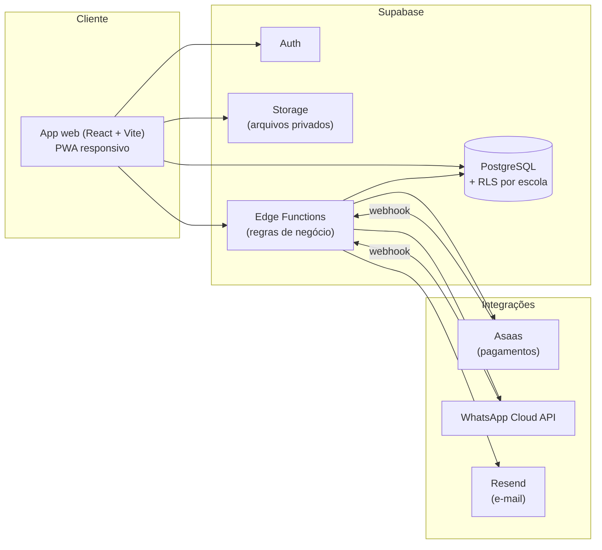

<div align="center">

# GSchool

**Gestão escolar simples para escolas pequenas: cobrança automática, comunicação pelo WhatsApp da escola e menos papel para as educadoras.**


</div>

---

## Sobre o projeto

Escolas particulares de pequeno porte, principalmente de Educação Infantil e Fundamental I, costumam funcionar com planilhas, cadernos e grupos de WhatsApp. O resultado é retrabalho na secretaria, cobranças manuais e professoras que gastam horas com registros em papel.

O **GSchool** é um SaaS multi-escola (multi-tenant) que centraliza essa rotina em três frentes:

- **Financeiro:** mensalidades cobradas automaticamente por Pix, boleto ou cartão recorrente, com baixa automática e régua de cobrança.
- **Comunicação:** integração com o **número de WhatsApp que a escola já usa** (API oficial em modo coexistência), com caixa de entrada compartilhada, respostas automáticas e comunicados em massa.
- **Rotina pedagógica:** agenda diária, fotos das atividades com controle de consentimento, planejamento e pareceres descritivos com rascunho gerado por IA.

> Projeto em desenvolvimento ativo, criado como estudo e portfólio e com objetivo de virar um produto comercial. Os módulos estão sendo construídos um por vez; veja o [roadmap](#roadmap).

---

## Funcionalidades

Legenda: ✅ pronto · 🚧 em desenvolvimento · ⏳ planejado · **(ee)** módulo comercial

| Módulo | Funcionalidade | Status |
|---|---|---|
| Núcleo | Multi-tenant com isolamento por Row Level Security | ⏳ |
| Núcleo | Autenticação, perfis e permissões por papel | ⏳ |
| Núcleo | Log de auditoria de operações sensíveis | ⏳ |
| Acadêmico | Alunos, responsáveis, turmas e matrículas | ⏳ |
| Acadêmico | Frequência, notas e pareceres descritivos | ⏳ |
| Educadoras | Agenda diária, fotos com consentimento e planejamento | ⏳ |
| Documentos | Declarações, boletins e históricos em PDF verificável | ⏳ |
| Financeiro **(ee)** | Cobrança por Pix, Pix Automático, boleto e cartão recorrente | ⏳ |
| Financeiro **(ee)** | Baixa automática por webhook e régua de cobrança | ⏳ |
| Comunicação **(ee)** | WhatsApp da escola: caixa compartilhada e automações | ⏳ |
| Gestão **(ee)** | Painel do diretor com inadimplência e pendências | ⏳ |

---

## Arquitetura



- O **frontend** acessa o banco diretamente pelo SDK do Supabase, com uma chave pública (*publishable key*). A segurança fica no banco: **toda tabela tem RLS**, e um usuário só enxerga dados das escolas às quais está vinculado.
- As **regras que envolvem dinheiro ou terceiros** (cobranças, webhooks, envio de WhatsApp) rodam em **Edge Functions**, no servidor, com uma chave secreta que nunca chega ao navegador.
- O **modelo de dados** completo está documentado em [docs/arquitetura.md](docs/arquitetura.md) e, à medida que os módulos ficarem prontos, em [`docs/`](docs/).

---

## Stack

| Camada | Tecnologias |
|---|---|
| Frontend | React, TypeScript, Vite, Tailwind CSS, PWA |
| Backend | Supabase: PostgreSQL, Auth, Storage, Row Level Security, Edge Functions (Deno) |
| Integrações | Asaas (pagamentos), WhatsApp Cloud API, Resend (e-mail) |
| Qualidade | Migrations versionadas, testes de isolamento entre escolas, GitHub Actions |

---

## Segurança e privacidade

O sistema guarda dados de crianças e adolescentes, então segurança é um requisito desde o primeiro commit, não uma etapa final.

- **Isolamento entre escolas:** cada registro pertence a uma instituição (`institution_id`), e políticas de RLS impedem que uma escola veja dados de outra. Esse isolamento será coberto por **testes automatizados** (Tópico 1).
- **Menor privilégio:** permissões por papel (direção, secretaria, professora, financeiro, responsável). Atestados médicos e dados de saúde têm acesso ainda mais restrito.
- **Sem acesso livre do administrador da plataforma:** acesso excepcional aos dados de uma escola é temporário, aprovado e registrado em auditoria.
- **LGPD:** fotos de alunos só ficam visíveis com consentimento ativo do responsável; dados sensíveis ficam em armazenamento privado.
- **Segredos fora do código:** nenhuma chave real é versionada. O repositório só contém o [`.env.example`](.env.example).
- **Dados fictícios:** o desenvolvimento usa apenas dados inventados, nunca dados reais de alunos.

Encontrou uma vulnerabilidade? Veja a [política de segurança](SECURITY.md).

---

## Como rodar localmente

> As instruções serão completadas conforme os módulos forem implementados.

**Pré-requisitos:** Node.js (LTS), Git, [Supabase CLI](https://supabase.com/docs/guides/cli) e uma conta gratuita no [Supabase](https://supabase.com).

```bash
# 1. Clonar o repositório
git clone https://github.com/higorLTA/GSchool-SaaS.git
cd GSchool-SaaS

# 2. Configurar as variáveis de ambiente
cp .env.example .env
#    preencha com a URL e a publishable key do SEU projeto Supabase

# 3. Ligar o projeto ao seu Supabase e aplicar as migrations
supabase login
supabase link --project-ref SEU_PROJECT_REF
supabase db push
```

---

## Estrutura de pastas

```
GSchool-SaaS/
├── apps/
│   └── web/            # Frontend React + Vite
├── supabase/
│   ├── migrations/     # Alterações do banco, versionadas e em ordem
│   ├── functions/      # Edge Functions (regras de negócio no servidor)
│   └── tests/          # Testes de banco (RLS e isolamento)
├── ee/                 # Módulos comerciais (licença própria)
├── docs/
│   └── decisoes/       # Registros de decisões de arquitetura (ADRs)
├── .env.example        # Variáveis necessárias, sem valores reais
├── LICENSE             # AGPL-3.0
├── SECURITY.md
└── README.md
```

---

## Fluxo de trabalho

- **Branches:** `develop` (desenvolvimento, ligada ao banco de dev) e `main` (produção, protegida). Cada funcionalidade nasce em `topico/NN-nome` e entra em `develop` por Pull Request.
- **Commits:** padrão [Conventional Commits](https://www.conventionalcommits.org/pt-br/), com `feat:`, `fix:`, `docs:`, `test:` e `chore:`.
- **Banco de dados:** toda alteração é feita por migration versionada no Git, nunca manualmente pelo painel.
- **Decisões técnicas:** registradas como ADRs em [`docs/decisoes/`](docs/decisoes/).

---

## Roadmap

- [x] **0.** Setup do repositório e dos ambientes
- [ ] **1.** Banco de dados: núcleo multi-tenant, RLS e testes de isolamento
- [ ] **2.** Frontend: fundação, login e layout por perfil
- [ ] **3.** Banco de dados: pessoas e acadêmico
- [ ] **4.** Frontend: cadastros e importação por planilha
- [ ] **5.** Backend: financeiro (Asaas, webhook, régua de cobrança)
- [ ] **6.** Frontend: financeiro
- [ ] **7.** Backend: WhatsApp (coexistência e automações)
- [ ] **8.** Frontend: caixa de entrada e comunicados
- [ ] **9.** Rotina das educadoras
- [ ] **10.** Documentos e atestados
- [ ] **11.** Painel do diretor
- [ ] **12.** Deploy, CI/CD e conformidade com a LGPD

---

## Licença

Este projeto segue o modelo **open-core**:

- **Núcleo** (tudo fora da pasta `ee/`): [GNU AGPL-3.0](LICENSE). Você pode estudar, usar e modificar o código. Se oferecer uma versão modificada como serviço on-line, precisa publicar o código-fonte dessa versão sob a mesma licença.
- **Módulos comerciais** (pasta [`ee/`](ee/)): licença proprietária. O código é público para consulta, mas o uso em produção exige licença do autor. Veja [`ee/LICENSE`](ee/LICENSE).

O porquê dessa escolha está em [`docs/decisoes/0001-open-core.md`](docs/decisoes/0001-open-core.md).

---

## Autor

**Higor** — desenvolvedor , construindo o GSchool do zero como estudo de arquitetura SaaS, segurança de dados e produto.

[](https://github.com/higorLTA)
<!-- Adicione seu LinkedIn: [](https://www.linkedin.com/in/seu-perfil) -->
