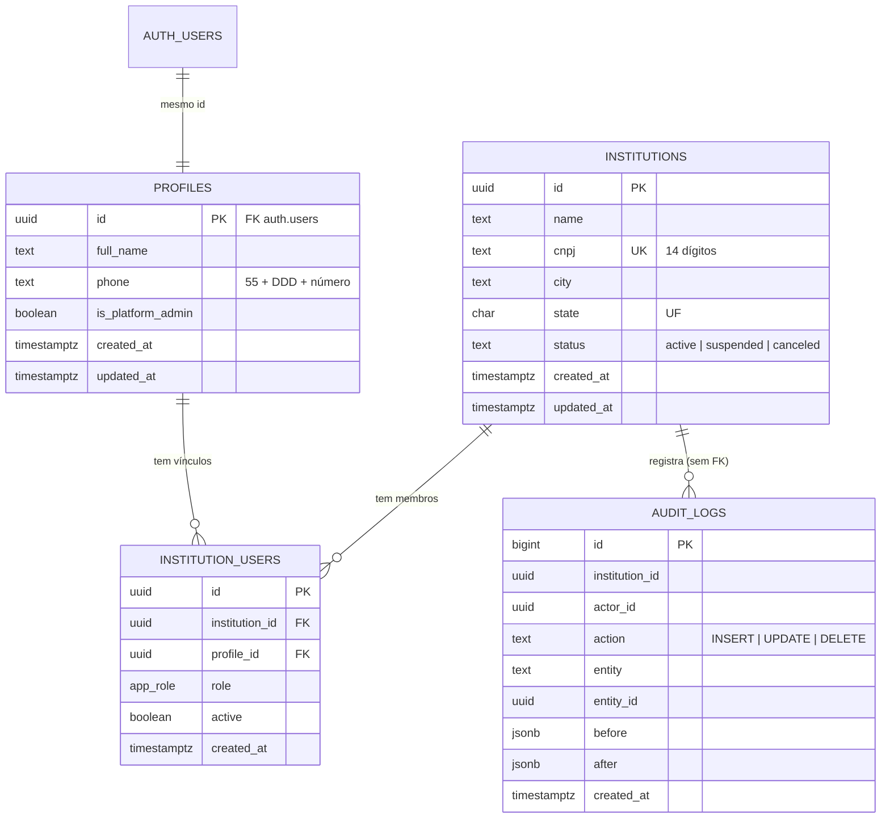

# Banco de dados — Núcleo multi-tenant

O núcleo é a base de segurança do GSchool: define as escolas (tenants), as pessoas, o vínculo entre elas e o registro de auditoria. Todas as tabelas têm **Row Level Security (RLS)** ativo, de forma que um usuário de uma escola nunca vê nem altera dados de outra.

Migrations: `supabase/migrations/*_nucleo_tabelas.sql`, `*_nucleo_funcoes.sql`, `*_nucleo_rls.sql`.
Testes: `supabase/tests/isolamento_nucleo.sql`.

## Diagrama

## Tabelas

| Tabela | Para que serve |
|---|---|
| `institutions` | Escolas clientes. CNPJ obrigatório (só dígitos). `status` controla se a escola está ativa, suspensa (ex.: inadimplência) ou cancelada. |
| `profiles` | Dados de cada usuário, 1 para 1 com `auth.users` (criado automaticamente no cadastro). Apagar o usuário apaga o perfil e os vínculos (LGPD). |
| `institution_users` | Vínculo pessoa × escola × papel (`director`, `secretary`, `teacher`, `finance`, `guardian`). Uma pessoa pode ter vários papéis e várias escolas. `active = false` tira o acesso sem apagar o histórico. |
| `audit_logs` | Quem alterou o quê e quando (antes/depois em JSON). Gravado só por trigger; ninguém altera ou apaga pela API. |

## Funções auxiliares (schema `private`, não exposto pela API)

| Função | Responde |
|---|---|
| `private.is_member(escola)` | O usuário logado tem vínculo ativo com a escola? |
| `private.has_role(escola, papéis[])` | O usuário logado tem um desses papéis na escola? |
| `private.shares_institution_with(perfil)` | O usuário logado e esse perfil têm uma escola em comum? |

Triggers: `updated_at` automático, criação do perfil no cadastro, proteção de `is_platform_admin` e auditoria em `institutions` e `institution_users`.

## Quem pode o quê

| Tabela | Ver | Criar | Alterar | Apagar |
|---|---|---|---|---|
| `institutions` | membros da escola | ninguém (admin da plataforma, futuro) | diretora | ninguém |
| `profiles` | o próprio + colegas de escola | automático no cadastro | o próprio (exceto `is_platform_admin`) | em cascata ao apagar o usuário |
| `institution_users` | membros da escola | diretora | diretora | diretora |
| `audit_logs` | diretora (da própria escola) | só o trigger | ninguém | ninguém |

Usuário não logado (`anon`) não vê nada em nenhuma tabela.

## Como testar

1. Criar os 4 usuários de teste no painel (Authentication → Add user).
2. Rodar `supabase/seed.sql` no SQL Editor do `gschool-dev`.
3. Rodar `supabase/tests/isolamento_nucleo.sql` no SQL Editor. Resultado esperado: `TODOS OS TESTES PASSARAM`.
